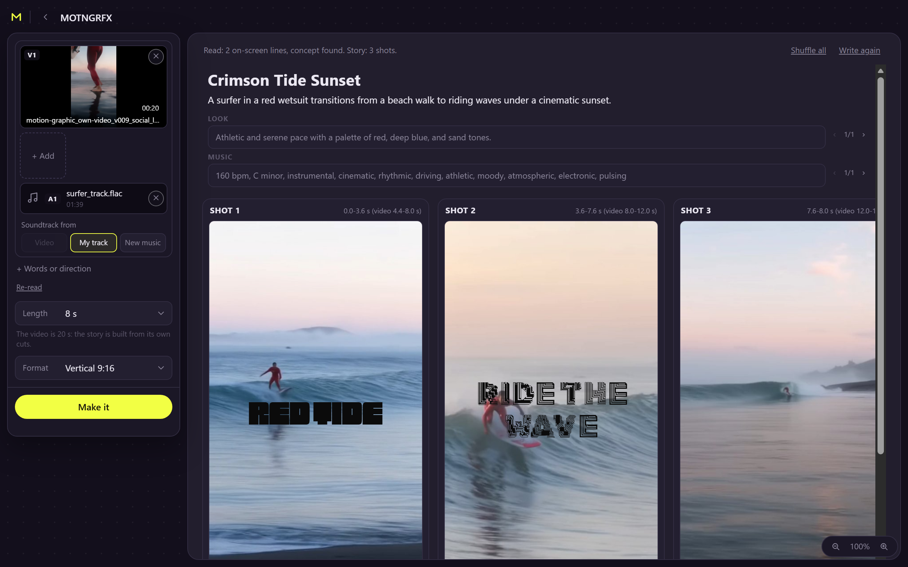

# MOTNGRFX

**MOTNGRFX** is a ComfyUI node pack plus a browser app that turns a song, a few images or a short brief into a finished kinetic-type motion graphic: 3D type that lands on the beat, woven into generated footage, in front of and behind the subject, with a produced soundtrack. It uses open weights only, and everything runs locally in ComfyUI on your own GPU (24 GB for the full build, smaller tiers below).

**Demo (1:58)**

https://github.com/user-attachments/assets/94c4fca0-fe98-47b0-83d4-14164bd34d59

**App walkthrough (1:01):** one project from dropped video to finished clip in the page; the waits are sped up 4x and labelled.

https://github.com/user-attachments/assets/532d4af9-4ed6-4041-8081-186ef82d108e

*The walkthrough ends on the app after a run: a real 8 s, 9:16 render of a surf clip with the user's own track, playing in the page with the Final (1080) and Download buttons.*

Download: [demo](docs/media/motngrfx-demo.mp4) (540x960, 8 MB) · [walkthrough](docs/media/motngrfx-walkthrough.mp4) (1280x800, 6 MB)

Example pieces made with the default graph:
[after-hours.mp4](app/examples/after-hours.mp4) · [city-on-the-beat.mp4](app/examples/city-on-the-beat.mp4) · [wild-bloom.mp4](app/examples/wild-bloom.mp4)

- **An open model directs the piece.** Gemma 4 (run by llama.cpp) reads your media, invents the shots, layout, fonts, cuts and music brief, and the pack executes that design.
- **Type sits between layers.** LTX 2.5 makes the footage, a subject matte and a clean background plate, so letters pass behind and in front of the subject or reveal footage through their own shapes.
- **The video model spells the real words.** Rendered text comes from a control pass of the actual graphic, so no invented letters.
- **3D depth cuts** (pivot, push, pullback, fly) transform the subject matte exactly like its picture. They are in the 24 GB graph; the 12 GB and 16 GB graphs use plain cuts.
- **Every component is saved**: stills, clean clips, mattes, type passes, piece JSON, music.

## Which setup do I need?

| GPU VRAM | Graph to use | Design model | Download | Time per piece |
|---|---|---|---|---|
| 12 GB (RTX 3060) | `motngrfx_3060` | Gemma 4 12B Q6_K | 78.3 GiB, 18 files | 12 s piece: 910 s; 16 s pieces: mean 1302 s (951-1630 s). Measured on an earlier graph version on a 3060. |
| 16 GB | `motngrfx_16gb` | Gemma 4 12B Q8_0 | 87.6 GiB, 18 files | not measured |
| 24 GB (RTX 4090 / 3090) | `motngrfx_default` | Gemma 4 31B QAT (Q4_K_XL) | 101.8 GiB, 18 files | 16 s pieces on an RTX 4090 (shared card): 933-1059 s compute, 1181-1490 s wall. The 3090 is not measured. |

- Sizes come from `scripts/download_models.py --dry-run` for each graph. The script prints sizes in GiB. Six files per tier are gated (see step 4).
- The 24 GB tier is the one the examples were made with. The 12 GB and 16 GB graphs load; they were not run end to end on the current graphs. The 3060 time above is from an earlier graph.
- Plan for 64 GB of system RAM and about 170 GB of free disk on the 24 GB tier.
- No GPU: the `local_v1` template needs no models and runs on CPU (a 12 s 360x640 draft in about 10 s).

## Install

Requirements: a recent ComfyUI (tested with 0.43.1; the pack uses the v3 node API, `comfy_api.latest`), Python 3.12 in the same environment as ComfyUI, `ffmpeg` and `ffprobe` on `PATH`, and an NVIDIA GPU for the GPU templates. 0.43.0 (the vast.ai ComfyUI image) installs the pack and its requirements; the full run was tested on 0.43.1.

Run every `python` command below with the Python that runs ComfyUI (on the vast.ai ComfyUI image: `/venv/main/bin/python`), and read `ComfyUI` in the paths as your ComfyUI folder (vast.ai ComfyUI image: `/opt/workspace-internal/ComfyUI`). Install packages with `python -m pip`, not a bare `pip`, so they land in that environment.

1. **Clone the pack into ComfyUI and install its Python packages.**

   ```bash
   cd ComfyUI/custom_nodes
   git clone https://github.com/okkazoo/MOTNGRFX ComfyUI-MOTNGRFX
   python -m pip install -r ComfyUI-MOTNGRFX/requirements.txt      # ComfyUI's own Python
   ```

   Optional: `requirements-music.txt` is for the sampled-instrument music engine (`mograph/sampled.py`); it downloads SoundFont banks into `~/.cache/mograph/banks`.

2. **Clone the other node packs the GPU graphs use.**

   ```bash
   cd ComfyUI/custom_nodes
   git clone https://github.com/Lightricks/ComfyUI-LTXVideo
   git clone https://github.com/yuvraj108c/ComfyUI-Video-Depth-Anything
   git -C ComfyUI-LTXVideo checkout 3bf3ca6      # the commit the graphs were tested with
   python -m pip install -r ComfyUI-LTXVideo/requirements.txt -r ComfyUI-Video-Depth-Anything/requirements.txt
   ```

   After cloning, check out the commit the graphs were tested with: `git -C ComfyUI-LTXVideo checkout 3bf3ca6`. The packs' requirements install `colour-science`. Install `kornia==0.7.4` (`python -m pip install kornia==0.7.4`) only if the node pack reports missing pyramid helpers. [ComfyUI-VideoHelperSuite](https://github.com/Kosinkadink/ComfyUI-VideoHelperSuite) is optional; no shipped graph uses it.

3. **Install the CUDA build of `llama-cpp-python`.** Gemma runs in llama.cpp and this package is not in `requirements.txt`. Do not use plain `python -m pip install llama-cpp-python`: PyPI only has the CPU source build. The tested build is the JamePeng 0.4.5+cu130 wheel (Linux x86_64, CPython 3.12, CUDA 13; cp310, cp311, cp313 and cp314 wheels are in the same release):

   ```bash
   python -m pip install --no-deps "https://github.com/JamePeng/llama-cpp-python/releases/download/v0.4.5-cu130-linux-20261025/llama_cpp_python-0.4.5%2Bcu130-cp312-cp312-linux_x86_64.whl"
   python -m pip install diskcache
   python -c "import torch, os, llama_cpp; llama_cpp.ggml_backend_load_all_from_path(os.path.join(os.path.dirname(llama_cpp.__file__), 'lib').encode()); print(llama_cpp.llama_supports_gpu_offload())"   # must print True
   ```

   Import `torch` first: a bare `import llama_cpp` prints `False` even when the install is fine, because the CUDA backend loads when a model is opened.

4. **Accept the LTX licence and set a Hugging Face token.** The LTX 2.5 transformer, text encoder, VAEs and upscaler are in the gated repo `Lightricks/LTX-2.5`. The Alpha-Gen and Clean-Plate IC-LoRAs are in `Lightricks/LTX-2.5-22b-IC-LoRA-Alpha-Gen` and `Lightricks/LTX-2.5-22b-IC-LoRA-Clean-Plate`. Open each repo page while logged in to Hugging Face and accept its licence. Then create a read token at <https://huggingface.co/settings/tokens> and export it:

   ```bash
   export HF_TOKEN=hf_xxx      # your own read token
   ```

   Instead of exporting the variable you can run `huggingface-cli login` once: `download_models.py` also reads the token file it writes (`$HF_HOME/token`, default `~/.cache/huggingface/token`). The downloader never prints the token; its first lines say `HF token: set (env)`, `HF token: set (token file)` or `HF token: not set`. Check this with `--dry-run` before the large download. All other files are public.

5. **Download the models for your tier.** Replace `<tier>` with `3060`, `16gb` or `default`. Add `--dry-run` first to see the list and sizes; `--skip-gated` leaves out the gated files.

   ```bash
   cd ComfyUI/custom_nodes/ComfyUI-MOTNGRFX
   python scripts/download_models.py --comfy /path/to/ComfyUI --graph app/graphs/motngrfx_<tier>.json
   ```

   Start the download once, in `tmux` or under `nohup` (the 24 GB tier is about 100 GiB). The script holds a lock file (`.motngrfx_download.lock`) in the models folder, so a second copy refuses to start instead of corrupting the `.part` files. Progress uses carriage returns: redirect to a log and read it with `tr '\r' '\n' < log | tail`.

   The script scans the graph for file names, puts each file in the right `models/<folder>/`, skips files that exist with the right size and resumes partial downloads. The text encoders named `qwen_*_ace15` (ACE-Step) and `qwen3.5_9b_*` (MOSS-Image) are model components, not design models.

6. **Restart ComfyUI and open the app.** Start it with the flags below. The console should list `ComfyUI-MOTNGRFX` under "Import times for custom nodes" without a traceback. Then open `http://127.0.0.1:8188/motngrfx`.

   ```bash
   python main.py --listen 127.0.0.1 --port 8188 --mmap-torch-files --cache-ram 16 --use-sage-attention
   ```

   - `--mmap-torch-files --cache-ram 16`: without them ComfyUI was OOM-killed at the LTX load on a 62 GB machine, because the ACE, MOSS, LTX and Gemma weights were all held in RAM at once. The page warns when it sees ComfyUI started without them.
   - `--use-sage-attention` is optional (faster LTX attention). It needs the `sageattention` package; leave it out if that is not installed.

7. **Check the install (optional).**

   ```bash
   python scripts/check_install.py --url http://127.0.0.1:8188 --graph motngrfx_<tier>
   ```

   It reads `/object_info` and lists every node class and model file the graph needs that the server lacks, with the fix. Exit code 0 means nothing is missing. The app runs the same check when you open a template.

Restart ComfyUI after any later file change in the pack: a failed import is cached until the process restarts.

## Using the app

Open `http://127.0.0.1:8188/motngrfx` (`/mograph` is an alias). On a remote machine, tunnel the port first: `ssh -L 8188:127.0.0.1:8188 user@host`, then open the same URL locally. The page uses ComfyUI's own `/upload`, `/prompt`, `/ws`, `/view` and `/history` endpoints, so nothing else needs to run. The default page runs the 24 GB graph (`motngrfx_default`). For the 16 GB or 12 GB tier open `http://127.0.0.1:8188/motngrfx?graph=motngrfx_16gb` or `http://127.0.0.1:8188/motngrfx?graph=motngrfx_3060`.

1. **Drop media.** One Add-media box takes up to 5 still images **or** one video, plus one audio track. You can also paste text. Choose the soundtrack: **Video sound**, **My track** or **New music**. With a video, 16:9 is greyed out: video mode renders 9:16 only.
2. **Read.** Gemma reads the media. Whisper large-v3 (CPU) finds lyrics, and ffmpeg finds the real cuts in a video.
3. **Storyboard.** The page writes an editable storyboard: one card per shot (with a video, one card per real cut, showing its first frame), with words from your pasted text or the heard lyrics, and a liked font you can change with the ‹ › buttons. Every model-written field is editable, and ‹ › also steps a field through earlier versions.
4. **Make it.** Renders a 540x960 preview with the music (with a video, your own footage is the picture and the subject mattes are cut only for the span used; the server runs one video job at a time); the page shows plain steps while it works ([screenshot](docs/media/app-running.png)). **Final (1080)** on the finished clip upscales it with Real-ESRGAN to 1080x1920 without re-rendering.



- **Errors** name the failing stage, give a hint (out of memory, missing model, missing package) and keep the traceback behind a "Technical details" fold.
- **Cancel** removes your job from the queue and interrupts the server only if your job is the one running. **Run again** repeats a run with the same inputs and seed; **New seed** keeps the inputs and draws a new seed.
- **Dropped connections** (SSH tunnels do this) are survived: the page reconnects and follows the job through `/history`, so a run that finished while you were away still shows its result.
- **Missing nodes** are listed with the pack to clone; the page refuses to start a run that cannot work.
- **Lyrics need Whisper.** Whisper large-v3 (faster-whisper) runs on the CPU in a separate Python environment, so it never takes VRAM from Gemma. Install `faster-whisper` there and point `MOTNGRFX_ASR_PYTHON` at that environment's python. Without it the read still works, with no lyrics.

The page binds to API-format graphs in `app/graphs/<name>.json` by node `_meta.title`, described by a sidecar `<name>.app.json`. Examples are in `app/examples/`. `python app/smoke_local.py --port 8188 --graph local_v1` runs the same flow headless and prints per-node timings. Design notes: `16_app/PLAN.md` and `16_app/MEDIA_BOX.md`.

## How it works

A run goes through these stages. Each model is loaded on its own and freed before the next.

1. **Gemma 4 design.** Gemma 4 (31B QAT on 24 GB, 12B on 12 and 16 GB, via the `MographGGUFVL` node) writes the concept, shots, layout, type modules, liked fonts, cut kinds and a music brief. Code validates the reply, repairs it once if needed and fixes the timing itself.
2. **ACE-Step music.** ACE-Step 1.5 XL base writes the music from the brief and cuts it to the exact length on the beat grid.
3. **MOSS stills.** MOSS-Image makes one still per place in the piece (up to 6).
4. **LTX 2.5 image-to-video.** LTX 2.5 22B distilled (int8) turns each still into the shot's footage.
5. **Alpha-Gen matte.** The Alpha-Gen IC-LoRA cuts the subject out of the clean clip.
6. **Clean-Plate.** The Clean-Plate IC-LoRA removes the subject and its shadow, leaving an empty background.
7. **Video Depth Anything.** The Small model gives a depth guide for the footage and the 3D cuts.
8. **Type passes.** The designed 3D type is rendered by the module engine, including type-as-matte modes such as `reveal_subject`, `reveal_plate`, `subject_through` and `window_other`. An LTX Union-Control IC-LoRA pass renders the footage again under canny and depth guides of the designed graphic, so the text spells the real words.
9. **Compose.** On the GPU, type goes between background and subject; the result is encoded with the music.
10. **3D cuts.** Shot changes are depth-projected cuts (`pivot`, `push`, `pullback`, `fly`). The subject matte moves exactly like its picture, so no second copy of the subject appears.

Each piece draws its own random system before Gemma designs inside it: 2-3 cut kinds, a set of liked fonts sized to the length, and a palette taken from its own first still. Words land centred on a beat and stay alive while they hold. Effects such as `window_subject_front`, `plate_in_type`, `grid`, `column` and `contour_sweep` can be requested by name (`16_app/TRANSITIONS.md`).

### Models used

| Model | Role | Licence |
|---|---|---|
| Gemma 4 31B QAT / 12B (GGUF, llama.cpp) | design and media reading | Apache-2.0 |
| Gemma 4 12B (LTX text-encoder build) | LTX text encoder | Apache-2.0 |
| ACE-Step 1.5 XL base | music | MIT |
| MOSS-Image SFT | stills | Apache-2.0 |
| A small open image decoder | stills VAE inside the MOSS chain | Apache-2.0 |
| LTX 2.5 22B distilled + VAEs + upscaler | image-to-video footage | LTX-2.x Community License (gated) |
| LTX 2.5 IC-LoRAs Alpha-Gen and Clean-Plate; LTX 2.3 Union-Control | mattes, clean plate, text pass | LTX-2.x / LTX-2 Community License |
| Video Depth Anything Small | depth guide | Apache-2.0 |
| Real-ESRGAN x2plus / x4plus | Final (1080) upscale | BSD-3-Clause |
| Whisper large-v3 (faster-whisper, CPU) | lyrics | MIT |

## Nodes and workflows

All nodes are in the **MOTNGRFX** category (fusion nodes under **MOTNGRFX/Fusion**). Node ids keep the `Mograph` prefix so saved workflows still load. The graphs, their tiers and the helper folders are described in [`workflows/README.md`](workflows/README.md).

The original CPU pipeline (Analyze, Plan, Soundtrack, Render; no generative models) is available as these nodes:

| Node | Inputs | Outputs |
|---|---|---|
| **Mograph Analyze** | `text` (multiline; one line per beat of the story), `image_1..image_4` (optional; a batch counts as several images), `audio` (optional), `duration` (0 = auto, up to 15 s) | `analysis` |
| **Mograph Plan (Rules)** | `analysis`, `seed` | `plan`, `plan_json` |
| **Mograph Plan From JSON** | `analysis`, `plan_json` | `plan` (validated; raises with the list of problems) |
| **Mograph Soundtrack** | `plan`, `analysis` | `audio`: your audio trimmed and faded, or a synth music bed + sfx, mixed |
| **Mograph Render** | `plan`, `analysis`, `audio` (optional), `format` (9:16 / 16:9), `quality` (draft / full) | `video` |

Feed `video` into the core **Save Video** node to keep the file. The plan schema and validation rules are in `mograph/plan.py`.

## Folder map

| Folder | What is in it |
|---|---|
| `app/` | App graphs (`app/graphs/`), their `.app.json` sidecars, and the example pieces (`app/examples/`) |
| `web_app/` | The browser app, served by ComfyUI at `/motngrfx` |
| `nodes.py`, `nodes_fusion/`, `app_routes.py` | The ComfyUI nodes and the app's server routes |
| `mograph/` | The core engine: planner, renderer, type, fonts (`mograph/fonts/`) |
| `tools/` | Helper tools and the module engine behind the type passes |
| `scripts/` | `download_models.py` and `check_install.py` |
| `workflows/`, `example_workflows/` | API graphs used by the tools, and the old CPU graph. See [`workflows/README.md`](workflows/README.md) |
| `tests/` | The test suite |
| `docs/` | Screenshots, the demo and the walkthrough video |
| `licenses/`, `LICENSE`, `NOTICE`, `_info/` | Licences and notices; `_info/motion-principles.md` (the motion rules the planner follows) |
| `11_mathtype/`, `14_modules/`, `15_fusion/`, `16_app/` | Development folders. They hold design notes, benchmarks and test material. They are kept because code paths point into them. |

## Tests

```bash
pip install pytest pytest-timeout
cd ComfyUI-MOTNGRFX && python -m pytest --rootdir=tests tests -q
```

`--rootdir=tests` matters: pytest 9 otherwise tries to import the repo-root `__init__.py` as a package and every test errors at collection. The tests run on CPU without ComfyUI. `tests/test_runtime_paths.py` fails on any hard-coded absolute path, and `tests/test_install_scripts.py` keeps `scripts/download_models.py` in step with the models the graphs load.

Tests that read development-only files (the dev design graphs, the `15_fusion/` piece fixtures) skip themselves in this public export, so a skip with the reason "dev fixture not shipped in the public export" is expected. The known remaining failures are the 15 `test_depth_*` geometry and legibility threshold tests (`test_depth_flat_type` 1, `test_depth_ribbon_type` 1, `test_depth_slide_type` 3, `test_depth_transition_type` 8, `test_depth_type` 2), under investigation.

## Limits

- Only the 24 GB tier was run end to end, on RTX 4090 cards. The 3090, the 16 GB tier and the current 12 GB graph are not measured. Per-stage VRAM figures in `16_app/TIERS.md` are estimates.
- Final is a 540x960 render plus a Real-ESRGAN upscale to 1080x1920, not a native 1080 render.
- The `effects` field is not on the main Make-it form yet. Video mode takes one video (or up to 5 images) plus one audio track, renders 9:16 only (16:9 is greyed out when a video is loaded) and runs one video job at a time; it was only run on the 24 GB tier (`tools/app/own_video*.py`, `16_app/OWN_VIDEO.md`).
- The LTX licence is free under US$10M annual revenue; above that it needs a commercial agreement with Lightricks.
- The optional MOSS-Image edit LoRA (`chinoll/Moss-Image-Edit`, new-angle stills) is not part of any shipped graph and has no declared licence. `download_models.py --extras angles` fetches it only if you ask.
- The design model chooses shots and type, so pieces differ in taste and a run can still need a new seed.

## Licences

Code: **Apache-2.0** ([`LICENSE`](LICENSE)). Third-party notices are in [`NOTICE`](NOTICE). Licence texts are in [`licenses/`](licenses/) and beside the fonts in `mograph/fonts/` (`OFL-*.txt`).

Model weights are **downloaded, not redistributed**. Each stays under its own licence, and you must accept the terms where a download is gated.

- LTX-2.5 22B distilled, video/audio VAEs, spatial upscaler and the IC-LoRA Alpha-Gen (Lightricks): LTX-2.x Community License Agreement, 11 Aug 2026. Free for entities under US$10M annual revenue. https://github.com/Lightricks/LTX-2/blob/main/LICENSE-2_x (gated on Hugging Face).
- LTX-2.3 IC-LoRA Union-Control (Lightricks): LTX-2 Community License Agreement, 5 Jan 2026. https://github.com/Lightricks/LTX-2/blob/main/LICENSE-2
- LTX-2.5 IC-LoRA Clean-Plate (Lightricks): LTX-2.x Community License (gated on Hugging Face).
- Gemma 4 31B QAT (design model) and Gemma 4 12B (design model on smaller tiers; LTX text encoder with LTX projection layers) (Google): Apache License 2.0.
- ACE-Step 1.5 (ACE Studio / StepFun): MIT License. https://github.com/ace-step/ACE-Step-1.5
- MOSS-Image SFT (OpenMOSS) and its small open image decoder: Apache License 2.0. The text encoders bundled with ACE-Step and MOSS-Image (the `qwen_*_ace15` and `qwen3.5_9b_*` files) are model components under Apache License 2.0.
- Whisper large-v3 (OpenAI) via faster-whisper (SYSTRAN): MIT License; installed separately.
- Video Depth Anything Small (ByteDance / HKU): Apache License 2.0. The Base and Large models are CC BY-NC 4.0 and are not used.
- Real-ESRGAN (xinntao) `RealESRGAN_x2plus.pth` / `RealESRGAN_x4plus.pth`: BSD-3-Clause, used for the Final (1080) upscale.
- torchvision RAFT: code BSD-3-Clause; pretrained weights are downloaded by torchvision at run time.
- SageAttention (THU-ML): Apache License 2.0 (optional launch flag).
- Fonts in `mograph/fonts/` (42 liked ones allowed): SIL Open Font License 1.1; Ultra: Apache License 2.0 (`LICENSE-Ultra.txt`).
- SoundFont banks (optional, downloaded at run time, never committed): `licenses/banks/README.md`. Salamander Grand Piano V3 (Alexander Holm) is CC BY 3.0 and needs credit if used.
- Host and node packs: ComfyUI (GPL-3.0), ComfyUI-LTXVideo (LTX-2 Community License), ComfyUI-Video-Depth-Anything (Apache-2.0).

Generated media is AI-generated. Do not use these models to impersonate real people, or to produce unlicensed IP or unlawful content (see each model's acceptable-use policy).
